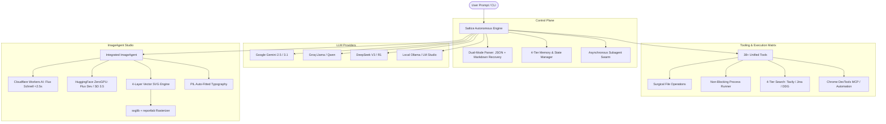

# 🧊 SalticeAgent — Autonomous AI Engineering & Visual Studio

[](https://opensource.org/licenses/MIT)
[](https://www.python.org/)
[](https://github.com/The-Do-ers)

**SalticeAgent** is a production-grade, autonomous engineering agent and creative studio. Built for multi-turn autonomous coding, surgical self-healing, multi-model LLM orchestration, and integrated visual asset synthesis (diffusion + mathematical vector SVG generation).

---

## ⚡ Key Highlights

- **Global Terminal CLI (`saltice`)**: Launch from anywhere in Windows, macOS, or Linux.
- **Dual-Mode Resilient Parsing**: Robust JSON parser with Markdown block recovery (`SalticeAntigravityEngine`) — never halts on imperfect LLM outputs.
- **Infinite Execution Runway & Self-Healing**: Captures compiler/test exit codes, tracebacks, and lint failures; analyzes line slices and applies surgical patches until verified.
- **Asynchronous Subagent Swarm**: Spawn specialized background worker threads (`planner`, `architect`, `tdd-guide`, `security-reviewer`, `image-agent`, `vector-designer`) that work in parallel.
- **Integrated ImageAgent & Vector Studio**:
  - **Edge Diffusion (<2.5s)**: Instant serverless generation powered by Cloudflare Workers AI (`@cf/black-forest-labs/flux-1-schnell`, SDXL).
  - **ZeroGPU Diffusion Matrix**: Multi-model parallel dispatch across Hugging Face Spaces (FLUX.1-dev, SD 3.5 Large) with Pollinations.ai fallback.
  - **4-Layer Resilient Vector SVG Engine**: Mathematical SVG synthesis with `<defs>` glowing gradients, Iconify registry integration (200k+ icons), curated presets, and lossless PNG rasterization via `svglib` + `reportlab`.
  - **Diffusion Typography & Wordmarks**: Automated PIL font auto-fitting to overlay crisp text on diffusion assets without AI hallucination.
  - **C.R.A.P. Design Validation**: Autonomous scoring of contrast, repetition, alignment, and proximity.
- **Multi-Tier Research Matrix**: Automated failover across Tavily AI, Google News RSS, Jina AI Reader, and DuckDuckGo.
- **Karpathy & ECC Directives**: Built-in adherence to simplicity, surgical edits, and goal-driven verification.

---

## 🏗 Architecture Overview



---

## 🚀 Quickstart & Installation

### 1. Clone the Repository
```bash
git clone https://github.com/The-Do-ers/SalticeAgent.git
cd SalticeAgent
```

### 2. Set Up Virtual Environment & Dependencies
```bash
python -m venv .venv

# On Windows (PowerShell)
.\.venv\Scripts\Activate.ps1

# On Linux / macOS
source .venv/bin/activate

# Install requirements
pip install -r requirements.txt
```

### 3. Configure Environment Variables
Copy `.env.example` to `.env` and fill in your API keys:
```bash
cp .env.example .env
```
*(At minimum, configure `GEMINI_API_KEY` or `GROQ_API_KEY` for LLM operations. Add `CLOUDFLARE_ACCOUNT_ID` and `CLOUDFLARE_API_TOKEN` for sub-2.5s image generation).*

### 4. Install Global CLI Command (Optional)
```bash
pip install -e .
```
Now you can run `saltice` from any directory!

---

## 🖥 Usage

### Interactive Shell
```bash
saltice
```
Starts the interactive agent session with live streaming, syntax highlighting, and autonomous execution.

### Single Prompt Mode
```bash
saltice "Build a FastAPI REST service with JWT auth and write pytest test cases"
```

### Visual & Logo Generation CLI
You can also invoke the `image_agent` module directly:
```bash
# Generate a fast diffusion image with Cloudflare Flux Schnell
python -m image_agent.cli --prompt "Cybernetic cityscape at sunset" --output artifacts/city.png

# Generate a high-resolution mathematical vector SVG logo
python -m image_agent.cli --logo "Quantum security shield with cyan gradients" --style modern-tech --output artifacts/shield.svg
```

---

## 🛠 Unified Tool Suite (Highlights)

| Category | Tools | Description |
| :--- | :--- | :--- |
| **Filesystem** | `read_file`, `write_file`, `replace_file_content`, `view_file_slice` | Surgical, non-destructive file reading, creation, and line-level diff patching. |
| **Execution** | `run_command`, `run_tests` | Non-blocking execution of tests, compilers, and linters with exit code analysis. |
| **Web & Research** | `search_web`, `fetch_webpage`, `tavily_search` | Multi-provider fallback web scraping and deep synthesis. |
| **Subagents** | `spawn_subagent`, `check_subagent_status`, `list_subagents` | Asynchronous multi-threading for delegated tasks. |
| **Visual Studio** | `generate_image`, `generate_svg_logo`, `inspect_image_quality` | Parallel diffusion, SVG vector design, typography typesetting, and image quality checks. |
| **Inspection** | `get_workspace_summary`, `view_file_outline` | AST-aware code navigation and directory mapping. |

---

## 👥 Subagents & Modular Skills

SalticeAgent includes pre-configured specialized personas in `subagents.py`:
- `planner`: Decomposes complex projects into testable milestones.
- `architect`: Enforces low-coupling module design and clear boundaries.
- `tdd-guide`: Writes unit and integration tests before implementation.
- `code-reviewer`: Reviews security, performance, and anti-regression.
- `image-agent`: Autonomous visual studio for diffusion mockups and UI assets.
- `vector-designer`: Mathematical SVG geometry and brand mark synthesizer.

Skill modules are loaded dynamically from `skills/`:
- `creative-web-design`: Awwwards-grade layouts, typography, and visual patterns.
- `gsap-lenis-motion`: Smooth scroll and timeline animations.
- `kokonut-ui` & `react-bits`: Modern interactive component libraries.
- `test-driven-development`: Pytest workflows and verification gates.
- `image-agent`: Visual asset and vector generation blueprints.

---

## 🔐 Security & Best Practices

- **Never commit `.env`**: SalticeAgent includes a strict `.gitignore` that ignores `.env`, runtime databases (`telemetry.db`), session logs, and cache files.
- **Non-blocking Dev Servers**: As per the engineering directives, SalticeAgent verifies code using non-blocking commands (`npm run build`, `pytest`, `python -m unittest`) and avoids hanging background servers.
- **Surgical Edits**: Edits are performed using `replace_file_content` targeting exact anchors to avoid wiping existing implementations.

---

## 🤝 The Do'ers Organization

Maintained by **The-Do-ers** team.
- Organization: [https://github.com/The-Do-ers](https://github.com/The-Do-ers)
- Contributing: Fork the repository, create a feature branch, and submit a pull request.
